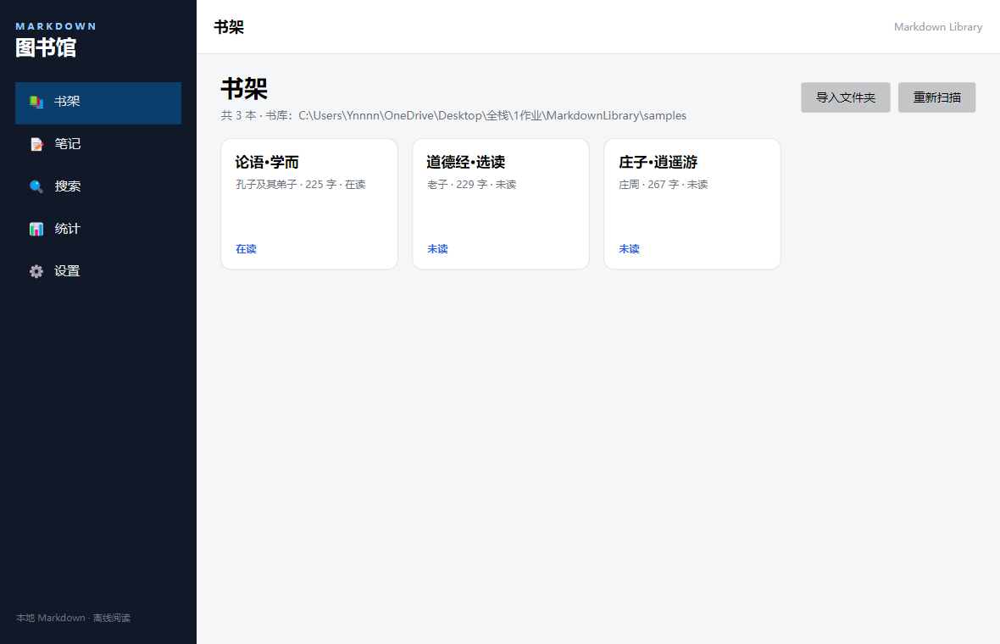
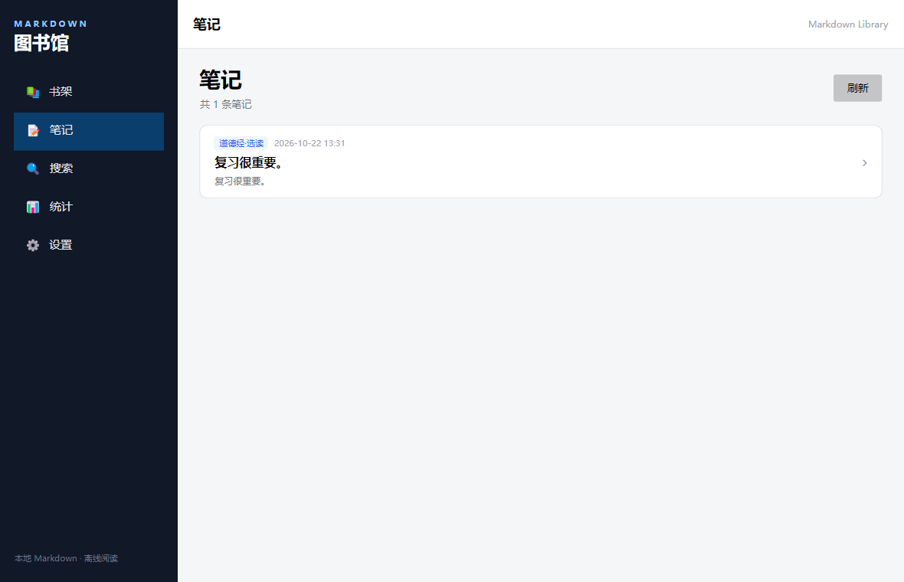
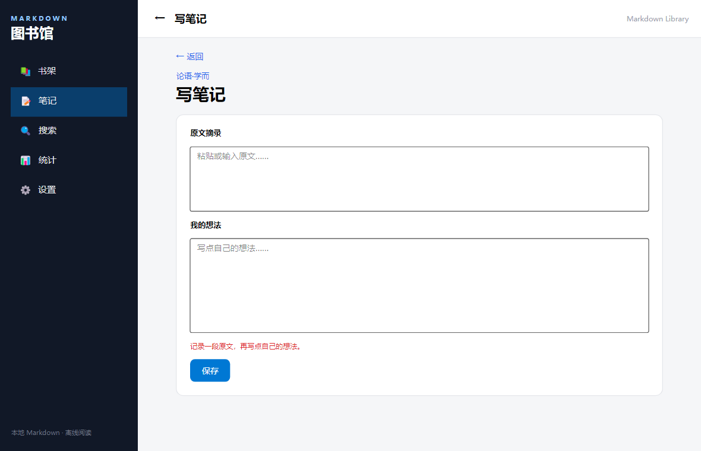
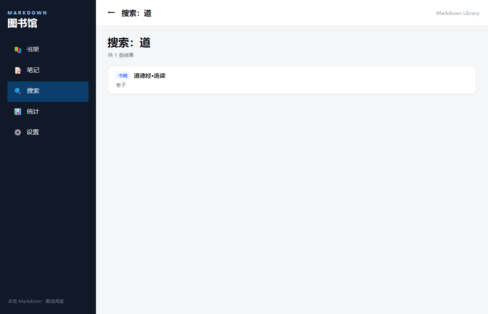
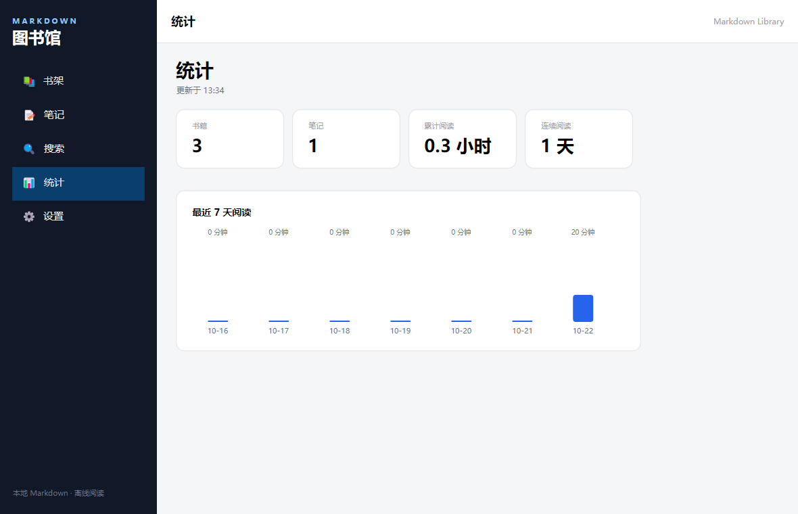

# Markdown 图书馆

一个本地、离线的 Markdown 阅读与笔记应用：把散落在文件夹里的 `.md` 文件收进书架，支持目录、阅读进度、摘录笔记与阅读统计。

项目采用 **Avalonia + MVVM + SQLite**，目标是对齐课程要求中的分层思想：视图与视图模型分离、接口抽象、依赖注入、三层导航、ViewLocator、异步 IO 服务化。



## 已实现功能

| 模块 | 能力 |
|---|---|
| 书架 | 递归扫描文件夹、导入书库、重新扫描、书籍卡片、阅读状态 |
| 书籍详情 | 标题/作者/字数/状态、阅读进度、笔记数量、内容简介预览、写笔记 |
| 阅读器 | Markdown 渲染（标题、列表、引用、表格、代码块）、目录、相对路径图片、进度保存与恢复 |
| 笔记 | 全部笔记列表、新建/编辑/删除、按更新时间排序 |
| 标签 | 在书籍详情添加/移除标签，多对多存储 |
| 搜索 | 书名、作者、笔记内容检索；结果可跳到详情或笔记 |
| 统计 | 书籍数、笔记数、累计阅读时长、连续阅读天数、最近 7 天柱状图 |
| 设置 | 书库目录选择、重新扫描、数据位置说明 |
| 导航 | 侧边菜单切换 + 内容页返回栈（详情 → 阅读器/笔记 → 返回） |
| 数据层 | SQLite 建库建表、书籍/笔记/标签/进度/阅读会话的存储实现 |

目前共 **11 个页面**：主窗口、主界面、书架、书籍详情、阅读器、笔记列表、笔记编辑、搜索、搜索结果、统计、设置。

## 环境与运行

要求：**.NET 8 SDK**（Windows 10/11）。

```powershell
dotnet restore
dotnet run --project src/MarkdownLibrary
```

首次打开是空书架：

1. 点击右上角 **导入文件夹**
2. 选择仓库里的 `samples` 目录（内含三本公版古籍节选）
3. 书架出现书籍后，点卡片进入详情，再点 **开始阅读**

### 数据位置

| 内容 | 默认路径 |
|---|---|
| 数据库 | `%APPDATA%\MarkdownLibrary\library.db` |
| 偏好设置 | `%APPDATA%\MarkdownLibrary\preferences.json` |
| 默认书库 | `%USERPROFILE%\Documents\MarkdownLibrary` |

开发时可用环境变量覆盖：

```powershell
$env:MDLIB_DATA_DIR = "$PWD\.data"
$env:MDLIB_LIBRARY_DIR = "$PWD\samples"
dotnet run --project src/MarkdownLibrary
```

### 测试

```powershell
dotnet test
```

共 10 条单元测试：Markdown front matter / 目录解析、字数统计、笔记新增与删除、搜索跳转。

也可以直接跑数据层自检：

```powershell
$env:MDLIB_DATA_DIR = "$PWD\.data-smoke"
dotnet run --project tools/Smoke -- samples
```

它会扫描 `samples`、写一条进度/笔记/阅读会话，并打印统计结果。

### 界面预览

| 笔记列表 | 笔记编辑 |
|---|---|
|  |  |

| 搜索结果 | 统计 |
|---|---|
|  |  |

## 目录结构

```
MarkdownLibrary/                     # 项目根
├── MarkdownLibrary.sln
├── src/
│   ├── MarkdownLibrary/             # UI 壳（Avalonia）
│   │   ├── Views/                   # axaml + 极薄 code-behind
│   │   ├── Services/                # 三层导航实现、Alert、FileDialog
│   │   ├── ViewLocator.cs           # VM -> View 命名约定
│   │   ├── ServiceLocator.cs        # ServiceCollection 集中组装
│   │   └── App.axaml / Program.cs
│   └── MarkdownLibrary.Library/     # 业务核心（不引用 Avalonia）
│       ├── Models/                  # Book / Note / Tag / ReadingProgress ...
│       ├── Services/                # 接口 + SQLite / Markdown 实现
│       ├── ViewModels/              # 页面 ViewModel
│       └── Helpers/                 # 路径、字数统计
├── tests/
│   └── MarkdownLibrary.UnitTest/    # xUnit
├── tools/Smoke/                     # 数据层自检（不在 sln 中）
├── samples/                         # 三本 Markdown 示例书
├── docs/screenshots/                # 报告用截图
├── README.md
└── package.ps1
```

## 架构说明

### 1. MVVM 分层

- `Models/`：纯数据载体（`Book`、`Note`、`ReadingProgress` 等），由 Dapper 直接映射
- `ViewModels/`：交互逻辑、状态、命令
- `Views/`：只做布局与绑定，code-behind 只保留滚动、点击转发等少量代码

`MarkdownLibrary.Library` **不引用 Avalonia**，可以脱离 UI 单独测试。

### 2. 导航参数注入

```csharp
public abstract class ViewModelBase : ObservableObject
{
    public virtual string PageTitle => "Markdown 图书馆";
    public virtual void SetParameter(object parameter) { }
}
```

`BookDetailViewModel`、`ReaderViewModel` 覆写 `SetParameter`，导航层在切换前传入 `Book`，ViewModel 不感知导航来源。

### 3. 三层导航

| 接口 | 职责 | 常量类 |
|---|---|---|
| `IRootNavigationService` | 根页面（主界面 / 预留初始化页） | `RootNavigationConstant` |
| `IMenuNavigationService` | 侧边菜单切换内容区 | `MenuNavigationConstant` |
| `IContentNavigationService` | 详情、阅读器入栈与返回 | `ContentNavigationConstant` |

返回栈由 `MainViewModel.ContentStack` / `PushContent` / `GoBack` 维护：**接口定义能力，ViewModel 维护状态**。

### 4. 轻量 ServiceLocator

`ServiceLocator.Initialize()` 中用 `ServiceCollection` 注册全部接口与实现，UI 只通过属性取 ViewModel：

```csharp
services.AddSingleton<IDatabase, SqliteDatabase>();
services.AddSingleton<IBookStorage, SqliteBookStorage>();
services.AddSingleton<IMarkdownService, MarkdownService>();
services.AddSingleton<IContentNavigationService, ContentNavigationService>();
```

### 5. ViewLocator

`ViewLocator` 实现 `IDataTemplate`，按命名约定把 `MarkdownLibrary.Library.ViewModels.XxxViewModel` 映射到 `MarkdownLibrary.Views.XxxView`，`ContentControl` 自动渲染。

### 6. IO 服务化与异步

文件扫描、Markdown 解析、SQLite 访问全部是 `async Task`，通过接口注入；UI 线程不阻塞。搜索、统计同样走服务层，后续替换实现不影响 ViewModel。

## 数据模型

```
books ──< notes
  │  └──< book_tags >── tags
  ├──1:1── reading_progress
  └──< reading_sessions
```

- `books`：书名、作者、文件路径（唯一）、封面、字数、状态、时间
- `notes`：所属书籍、摘录、想法、时间
- `tags` / `book_tags`：多对多标签
- `reading_progress`：`heading_index` + `offset_ratio`，应对窗口重排
- `reading_sessions`：起止时间与分钟数，用于统计与连续天数

## 已知限制与下一步

- 阅读进度用“标题索引 + 章内比例”近似恢复，极端排版下可能有几十像素偏差
- 暂未提供字号/主题切换（Markdown 控件当前使用默认样式）
- 标签只支持在书籍详情里添加/删除，还没有独立的标签管理页
- 大文件（>2MB）首次渲染会稍慢，后续可做分块渲染
- 下一阶段：初始化向导、全文搜索升级到 FTS5、字号/主题设置、标签筛选

## 打包提交

```powershell
powershell -ExecutionPolicy Bypass -File .\package.ps1
```

会在 `MarkdownLibrary` 外层的作业目录生成 `MarkdownLibrary-src.zip`（约 0.2 MB），只包含源码、示例书、文档与截图，自动排除 `bin/obj/.data/.nuget/.dotnet`。

## 开发辅助

应用支持两个开发用参数（不影响正常使用）：

- `--smoke`：启动后 4 秒自动退出，用于确认 DI、数据库、XAML 能正常初始化
- `--smoke-deep`：自动走一遍全部页面（书架、笔记、搜索、统计、详情、阅读器）并输出截图到数据目录

```powershell
dotnet src\MarkdownLibrary\bin\Debug\net8.0\MarkdownLibrary.dll --smoke-deep
```
